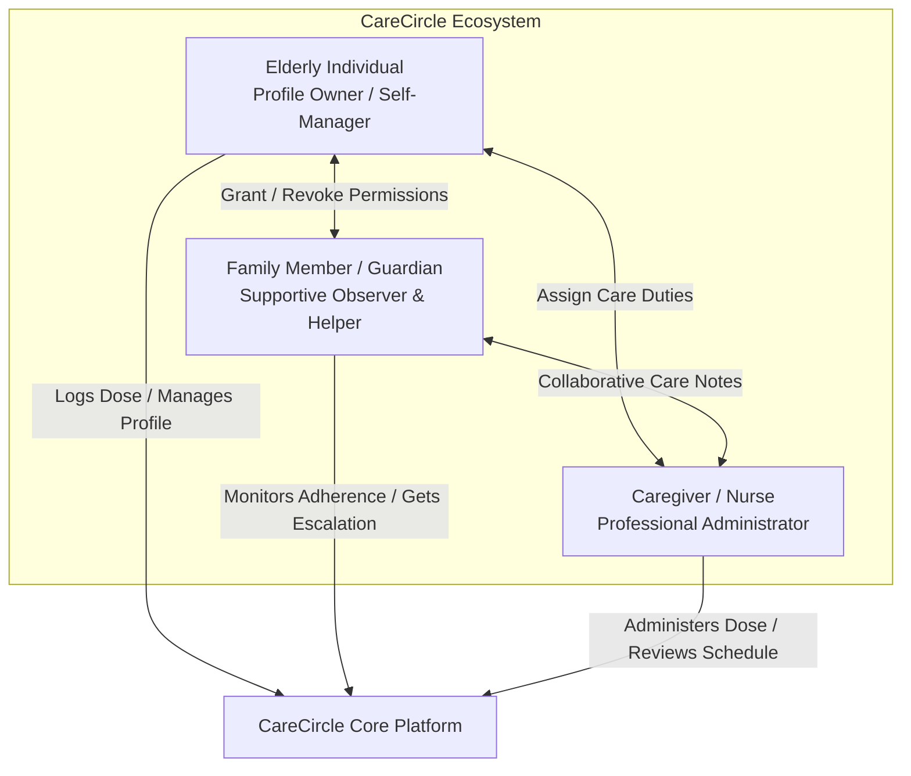
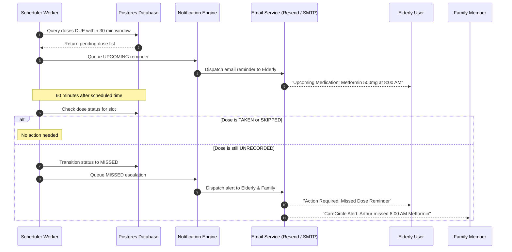

# CareCircle — Product Requirements Document (PRD)

**Project Name:** CareCircle  
**Tagline:** Connected Care. Independent Living.  
**Category:** Elderly Care & Medication Management Platform  
**Version:** 1.0.0  
**Status:** Approved for Architectural Design & Implementation  

---

## 1. Executive Summary & Vision

### 1.1 The Challenge
Modern elder care faces a critical dilemma: elderly individuals strongly desire independence and dignity in their own homes, while families and professional caregivers experience persistent anxiety regarding medication adherence, overlooked medical appointments, and emerging health risks. Existing solutions typically fall into two flawed categories:
1. **Rudimentary smartphone reminder alarms:** Easily dismissed, offer no accountability, lack family visibility, and fail to track whether the pill was physically consumed.
2. **Intrusive surveillance or clinical SaaS tools:** Complex, condescending, and strip elderly individuals of autonomy.

### 1.2 The CareCircle Solution
CareCircle is an interconnected, dignity-first healthcare coordination platform. It places the elderly individual squarely at the center of their own care decisions, while seamlessly uniting family members and professional caregivers into a synchronized, permission-governed care circle.

CareCircle goes far beyond reminder alarms:
- **Genuine adherence tracking** with double-entry dose verification and multi-stage escalation.
- **Role-tailored interfaces** designed according to geriatric accessibility science (WCAG 2.1 AAA high-contrast, oversized touch targets, clear cognitive chunking).
- **Automated multi-channel notifications** (automated email and in-app alerts) for upcoming doses, due doses, missed dose alerts to family guardians, and doctor appointment logistics.
- **Deep Google Services integration** including Google Calendar bidirectional synchronization for medical appointments and Google OAuth.
- **Robust zero-trust security** with role-based access control (RBAC), row-level security (RLS), hashed access passcodes, and end-to-end audit logging.

---

## 2. Product Objectives & Success Metrics

### 2.1 Core Business & Healthcare Objectives
- **Empower Independence:** Enable seniors to confidently manage daily medication regimens without feeling infantilized.
- **Close the Caregiver Communication Gap:** Provide real-time transparency to authorized family members and caregivers without requiring anxious phone calls.
- **Mitigate Adverse Drug Events (ADEs):** Prevent double-dosing and chronic non-adherence through strict dose-state transitions and safety lockouts.
- **Reliable Appointment Coordination:** Eliminate missed clinical consultations through integrated scheduling and Google Calendar event sync.

### 2.2 Key Performance Indicators (KPIs) & Evaluation Signals
| Dimension | Metric | Target |
| :--- | :--- | :--- |
| **Adherence Accuracy** | Discrepancy between logged state and physical action | Zero duplicate logs; 100% auditable history |
| **Notification Reliability** | Delivery rate of scheduled email and system alerts | > 99.5% delivery within 60s of trigger window |
| **Accessibility Score** | Lighthouse Accessibility & WCAG 2.1 AA/AAA compliance | 100% Lighthouse score; min 48px touch targets |
| **Security & Privacy** | IDOR / Unauthorized PHI exposure vulnerability | 0 vulnerabilities; 100% server-enforced RLS/RBAC |
| **Family Reassurance** | Verification latency of dose ingestion by caregiver | Instantaneous real-time update (< 2s) |

---

## 3. User Personas & Role Ecosystem

CareCircle implements strict, server-side role-based access control (RBAC) across three distinct personas:



### 3.1 Primary Persona: Elderly Individual (The Profile Owner)
- **Profile:** Arthur (age 78), lives independently. Takes 4 medications daily for hypertension and type-2 diabetes; attends bi-monthly cardiology visits. Mild arthritis and presbyopia.
- **Psychological Needs:** Retain independence, avoid feeling like a burden, eliminate confusion over pill schedules.
- **Platform Permissions:**
  - Full sovereignty over personal healthcare profile.
  - View large-print daily medication schedule (Morning, Afternoon, Evening, Bedtime).
  - One-tap "Mark as Taken" or "Skip" with optional reason.
  - View upcoming medical visits with transport/preparation instructions.
  - Invite family members and professional caregivers; set granular permissions.
  - Revoke any member's access at any time.
  - Receive automated email and visual reminders.
  - Access complete personal healthcare activity history.

### 3.2 Secondary Persona: Family Member / Guardian
- **Profile:** Sarah (age 46), Arthur's daughter. Works full-time, lives 30 miles away. Anxious about her father forgetting blood pressure medication.
- **Psychological Needs:** Peace of mind, early detection of missed doses before health deteriorates, ability to assist with doctor appointments.
- **Platform Permissions (Configurable by Elderly):**
  - View linked elderly profile(s).
  - Monitor real-time medication adherence and daily progress.
  - Receive immediate email alerts when a dose is missed past the grace period.
  - View upcoming clinical appointments; assist in scheduling (when granted edit rights).
  - View immutable care activity logs.

### 3.3 Tertiary Persona: Professional Caregiver / Home Health Aide
- **Profile:** Elena (age 34), visiting certified nursing assistant (CNA). Visits Arthur 3 days a week for morning vitals and medication assistance.
- **Psychological Needs:** Quick access to verified daily prescription schedules, clear documentation of doses administered during shift, reliable handoff communication.
- **Platform Permissions:**
  - Access assigned patient profiles from a consolidated caregiver roster.
  - View active prescriptions, dosage, timing, and physician instructions.
  - Record dose administration on behalf of the senior (logged as `RECORDED_BY_CAREGIVER` with actor identity).
  - View and add care notes regarding patient response or symptoms.
  - Receive shift-relevant reminders and escalation notices.

---

## 4. Functional Specifications & Core Modules

### 4.1 Module 1: Smart Medication Management & Scheduling
1. **Medication Record Schema:**
   - Medication Name (brand and generic).
   - Dosage Strength (e.g., 500, 25, 10).
   - Unit of Measurement (mg, mcg, mL, drops, tablets, puffs).
   - Route (Oral, Sublingual, Topical, Injection).
   - Prescribing Physician & Clinic Phone.
   - Refill Tracking: Pill quantity remaining, refill warning threshold.
   - Clinical Instructions (e.g., "Take with food", "Do not take with dairy").
   - Status (`ACTIVE`, `PAUSED`, `DISCONTINUED`).
2. **Schedule Engine & Timezone Awareness:**
   - Supports: Once Daily, Twice Daily (BID), Three Times Daily (TID), Four Times Daily (QID), Alternate Days, Weekly, or Custom Interval schedules.
   - Strict timezone persistence (ISO 8601 with timezone offset) ensuring patient travel does not corrupt scheduled dosage timing.
3. **Prescription Integrity Rule:** CareCircle **never** provides AI-generated dosage recommendations or independently alters prescription parameters. Any alteration requires explicit confirmation by an authorized user.

---

### 4.2 Module 2: Ground-Truth Adherence Tracking
CareCircle enforces an immutable, double-entry dose tracking model.
1. **Dose Life Cycle State Machine:**
   ```
   [UPCOMING] ──(Within window)──> [DUE] ──(User marks taken)──> [TAKEN]
        │                           │
        │                           └──(Grace period expires)──> [MISSED] ──(Late taken)──> [TAKEN_LATE]
        │
        └────────────────(User logs skip with reason)──────────> [SKIPPED]
   ```
2. **State Definitions:**
   - `UPCOMING`: Scheduled for a future time window (e.g. > 30 minutes away).
   - `DUE`: Currently within the active ingestion window (e.g., -30 min to +60 min of scheduled time).
   - `TAKEN`: Successfully confirmed. Records exact timestamp, actor ID, and dose ID.
   - `MISSED`: Window elapsed without confirmation. Automatically triggers notification escalation.
   - `SKIPPED`: User intentionally bypassed dose (e.g., fasting for lab work). Requires reason.
   - `TAKEN_LATE`: Dose confirmed after being marked missed.
3. **Anti-Duplication & Idempotency:**
   - Dose instances are keyed by `(medication_id, scheduled_date, dose_time_slot)`.
   - Database unique constraint prevents race conditions or double-logging.
   - Marking a dose taken immediately locks the record from being marked missed.
   - A reminder delivery never automatically assumes or marks a dose as taken.

---

### 4.3 Module 3: Smart Reminder & Notification Escalation Engine
A resilient notification engine operating via background workers and real-time dispatchers.



1. **Notification Categories:**
   - `MEDICATION_UPCOMING`: Sent 30 minutes before due time.
   - `MEDICATION_DUE`: Sent at the exact scheduled time.
   - `MEDICATION_MISSED`: Sent 45–60 minutes after due time if unrecorded (escalated to family).
   - `APPOINTMENT_UPCOMING`: Sent 24 hours and 2 hours before medical appointment.
   - `INVITATION_RECEIVED`: Sent when a senior invites family or caregiver.
   - `SECURITY_ALERT`: Sent upon new device login or passcode changes.
2. **Resilience & Anti-Spam Architecture:**
   - **Delivery Deduplication:** Every notification log contains a deterministic idempotency key `(user_id, event_type, reference_id, date_bucket)`.
   - **Retry Mechanism:** Failed dispatches retry up to 3 times with exponential backoff (1m, 5m, 15m) before dead-letter logging.
   - **User Preferences:** Users can toggle notification channels (Email, In-App) and quiet hours.

---

### 4.4 Module 4: Medical Appointment Management & Google Calendar Sync
1. **Appointment Records:**
   - Title / Reason (e.g., "Cardiology Follow-up").
   - Healthcare Specialist (Doctor Name, Specialty).
   - Medical Facility / Clinic Location (with address mapping).
   - Date, Start Time, End Time, Timezone.
   - Pre-appointment Preparation Notes (e.g., "Fasting from midnight", "Bring previous ECG").
   - Status (`SCHEDULED`, `COMPLETED`, `CANCELLED`, `RESCHEDULED`).
2. **Google Calendar Integration:**
   - Bi-directional or one-way synchronization using official Google Calendar API v3.
   - Creates dedicated calendar event with location, doctor details, and notification alarms.
   - Stores `google_event_id` in database to allow seamless updates and cancellations.
   - Handles OAuth token lifecycle (refresh token rotation, error states).

---

### 4.5 Module 5: Family & Caregiver Collaboration Ecosystem
1. **Invitation & Onboarding Flow:**
   - Elderly creates invitation specifying invitee email and designated role (`FAMILY` or `CAREGIVER`).
   - Generates cryptographically secure, time-bounded (72h) invitation token.
   - Invitee receives email, signs up or logs in, and accepts connection.
2. **Passcode-Protected Access Control:**
   - Sensitive profile modifications (or guest viewing) can optionally enforce a 4-to-6 digit profile passcode.
   - Passcodes are never stored plaintext; hashed with bcrypt/Argon2.
   - Exponential lockout after 5 consecutive failed attempts.
3. **Comprehensive Audit Trail (`activity_logs`):**
   - Every state change logs: `(timestamp, actor_id, target_profile_id, action_type, metadata, ip_address)`.
   - Examples: `DOSE_MARKED_TAKEN`, `MEDICATION_SCHEDULE_CREATED`, `APPOINTMENT_SCHEDULED`, `INVITATION_ACCEPTED`, `ACCESS_REVOKED`.

---

### 4.6 Module 6: Role-Based Healthcare Dashboards
1. **Elderly Dashboard ("Dignity First"):**
   - **Greeting & Time:** "Good morning, Arthur. Today is Thursday, Nov 15."
   - **Immediate Next Action:** Card showing the very next pill or appointment in 24pt+ bold text with high-contrast button: **[ Mark Taken ]**.
   - **Today's Timeline:** Visual cards for Morning, Noon, Evening, Bedtime doses.
   - **Quick Emergency / Family Connect:** One-tap card to contact primary family member.
   - **Zero Cognitive Clutter:** No confusing graphs, no multi-level nested menus.
2. **Family Dashboard ("Reassurance & Oversight"):**
   - **Patient Switcher:** Select between linked elderly parents/relatives.
   - **Adherence Scorecard:** Today's completion rate (e.g., "3 of 4 doses logged").
   - **Active Alert Banner:** Highlights any missed dose requiring follow-up.
   - **Upcoming Schedule:** 7-day lookahead of medication and clinic visits.
   - **Recent Activity Feed:** Real-time log showing when each dose was taken and by whom.
3. **Caregiver Dashboard ("Clinical Efficiency"):**
   - **Assigned Patient Roster:** Quick status badge for each client (All good, Dose due, Alert).
   - **Shift Administration List:** Unified chronological checklist of all medications to administer across assigned seniors today.
   - **Batch Administration Verification:** Allows swift, validated dose logging with caregiver signature/notes.

---

### 4.7 Module 7: Care Insights & Adherence Analytics
- **Calculated Adherence Rate:**
  $$\text{Adherence Rate} = \frac{\text{Taken Doses} + \text{Taken Late Doses}}{\text{Total Scheduled Doses} - \text{Skipped Validated}} \times 100\%$$
- **Weekly & Monthly Trend Visualizations:**
  - Displays day-by-day bar visual of adherence (Green: 100%, Amber: Partial, Red: Missed).
  - Identifies pattern trends (e.g., "Evening doses have a 40% missed rate").
- **Clinical Disclaimer:** Prominently stamped on all reports: *"CareCircle Adherence Insights are descriptive tracking logs based on user submissions and do not constitute clinical diagnosis or medical guidance."*

---

## 5. Non-Functional Requirements

### 5.1 Accessibility (WCAG 2.1 AA/AAA)
- Contrast ratio $\ge 7:1$ for primary text and interactive buttons.
- Base body font $\ge 16\text{px}$, headings $\ge 24\text{px}$, key dashboard buttons $\ge 20\text{px}$.
- Touch targets $\ge 48\times 48\text{px}$ (primary actions $\ge 56\text{px}$).
- Full keyboard tab navigation with visible focus rings.
- ARIA landmarks, roles, live regions for dynamically updating alerts.
- Respect `prefers-reduced-motion` and OS font scaling.

### 5.2 Performance & Scalability
- Time-to-First-Byte (TTFB) $< 200\text{ms}$ on serverless edge.
- First Contentful Paint (FCP) $< 1.2\text{s}$ on mobile 4G networks.
- Background worker execution cycle every 60 seconds with database query latency $< 50\text{ms}$.

### 5.3 Security, Privacy & Compliance
- Transport Layer Security: TLS 1.3 enforced.
- Authentication: Secure session cookies (`HttpOnly`, `SameSite=Lax`, `Secure`).
- Authorization: Multi-tenant Row-Level Security (RLS) guaranteeing zero cross-tenant leakage.
- Passwords & Passcodes: Bcrypt hash (work factor 12).
- Zero Plaintext Secrets: Environment variables managed server-side.

---

## 6. Required Screens Inventory (36 Screens)
The system architecture encompasses 36 functionally complete screens across Public, Onboarding, Elderly, Family, Caregiver, and Shared zones:
1. Public Landing Page
2. Product & Clinical Story
3. Secure Sign In
4. User Registration
5. Password Recovery
6. Role Selection & Verification
7. Elderly Healthcare Profile Setup
8. Family Member Invitation Setup
9. Caregiver Invitation Setup
10. Granular Access Permission Setup
11. Elderly Main Dashboard
12. Elderly Medication Management View
13. Elderly Medication Detail Modal / Page
14. Elderly Medication Schedule Planner
15. Elderly Medication Activity & History Log
16. Elderly Appointment Management View
17. Elderly Appointment Calendar View
18. Elderly Connected Family & Care Circle View
19. Elderly In-App Notification Center
20. Elderly Personal Accessibility & Profile Settings
21. Family Overview Dashboard
22. Family Connected Profiles Selector
23. Family Individual Senior Health View
24. Family Medication Adherence Monitor
25. Family Appointment Coordination Screen
26. Family Real-Time Activity Feed
27. Family Access & Permissions Management
28. Caregiver Shift Dashboard
29. Caregiver Assigned Patient Roster
30. Caregiver Daily Administration Schedule
31. Caregiver Dose Recording & Clinical Notes
32. Caregiver Appointment Overview
33. Shared Notification Center
34. Shared Profile Settings
35. Shared Security & Passcode Configuration
36. Shared Access Management & Revocation Console

