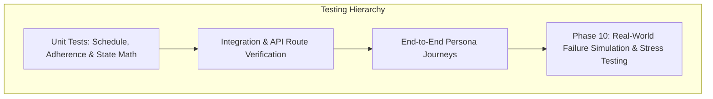

# CareCircle — Testing Strategy & Resilience Audit Protocol

**Standard:** Real-World Failure Simulation & Resilience Audit  
**Paradigm:** ANALYZE → VERIFY → REPORT → PLAN → ASK FOR APPROVAL → IMPLEMENT → TEST → VALIDATE  
**Document Version:** 1.0.0  

---

## 1. Testing Pyramid & Verification Framework

CareCircle employs a rigorous testing hierarchy ensuring clinical-grade reliability, data integrity, and geriatric usability:



---

## 2. Unit Testing Suite

### 2.1 Medication Scheduling Engine
- **Test Case US-01 (Daily Dose Generation):** Verify that a `ONCE_DAILY` schedule for `08:00 AM` in `America/New_York` (EDT/EST) generates UTC timestamps with exact timezone offsets.
- **Test Case US-02 (Multi-Dose BID/TID):** Verify that a `TID` schedule correctly calculates 3 distinct time slots (`08:00`, `14:00`, `20:00`) without interval drift.
- **Test Case US-03 (Daylight Saving Transition):** Verify that DST boundary days (spring forward / fall back) do not alter the physical wall-clock dose time for the patient.

### 2.2 Dose State Machine & Transitions
- **Test Case US-04 (Upcoming to Due):** Verify dose transitions to `DUE` when current time enters $[-30\text{m}, +60\text{m}]$ of scheduled time.
- **Test Case US-05 (Due to Taken):** Verify valid transition to `TAKEN` with timestamp and actor attribution.
- **Test Case US-06 (Due to Missed):** Verify transition to `MISSED` when time exceeds $+60\text{m}$ without action.
- **Test Case US-07 (Illegal Transition Invariance):** Assert that a dose marked `TAKEN` throws an `InvalidStateTransitionException` if any process attempts to transition it to `MISSED` or `UPCOMING`.

### 2.3 Genuine Adherence Formula Calculation
- **Test Case US-08 (Adherence Math):**
  $$\text{Adherence Rate} = \frac{N_{\text{taken}} + N_{\text{taken\_late}}}{N_{\text{total}} - N_{\text{skipped\_valid}}} \times 100$$
  - Verify with 20 scheduled doses: 18 taken, 1 taken late, 1 missed $\implies \frac{19}{20} \times 100 = 95.0\%$.
  - Verify that skipped doses with validated medical reasons (e.g., fasting) are excluded from the denominator.

### 2.4 Server-Side Permission & Authorization Checks
- **Test Case US-09 (RBAC Matrix):** Verify that a user with role `FAMILY` without `can_edit_medications` is rejected with `403 Forbidden` on `POST /api/medications`.
- **Test Case US-10 (Passcode Verification):** Verify that 5 failed PIN attempts trigger a 15-minute lock on elevated actions.

---

## 3. Integration Testing Suite

### 3.1 Authentication & Session Life Cycle
- Register new user $\to$ verify password is encrypted with Bcrypt (never plaintext).
- Sign in $\to$ verify secure `HttpOnly` session cookie issuance.
- Access protected route $\to$ verify middleware authorization.
- Sign out $\to$ verify session invalidation.

### 3.2 Medication Creation & Dose Slot Persistence
- Create medication with daily schedule $\to$ verify database rows in `medications`, `medication_schedules`, and `scheduled_doses`.
- Assert unique constraint on `(medication_schedule_id, scheduled_utc)` prevents duplicate slots.

### 3.3 Collaboration & Invitation Workflow
- Elderly invites family member via email $\to$ verify invitation token generated and hashed.
- Family member accepts token $\to$ verify row inserted into `care_circle_members` with correct granular permissions.
- Elderly revokes member access $\to$ verify immediate revocation of access to patient data.

### 3.4 Notification Dispatcher & Idempotency
- Queue upcoming reminder $\to$ verify dispatch through email adapter.
- Dispatch second reminder for identical dose slot $\to$ verify idempotency filter aborts dispatch with zero duplicate emails sent.

### 3.5 Google Calendar API Integration
- Create appointment $\to$ verify Google Calendar client formats event correctly.
- Verify storage of `google_event_id` and handle mock API error with retry flag.

---

## 4. End-to-End User Journey Tests

```mermaid
sequenceDiagram
    autonumber
    actor Senior as Arthur (Elderly)
    actor Family as Sarah (Family)
    participant App as CareCircle Web App
    participant DB as Postgres DB
    participant Email as Email Dispatcher

    Senior->>App: 1. Sign Up & Create Profile
    Senior->>App: 2. Add Medication: Metformin 500mg (8:00 AM)
    Senior->>App: 3. Invite Sarah (Child) as Family Guardian
    App->>Email: 4. Send Invitation Email with Token
    Family->>App: 5. Click Link, Sign In & Accept Circle
    
    Note over Senior,App: Morning Dose Time arrives (8:00 AM)
    App->>Senior: 6. Display "DUE NOW" Card in Elderly View
    Senior->>App: 7. Clicks "MARK AS TAKEN"
    App->>DB: 8. Record Dose Taken (Actor: Arthur)
    App->>Family: 9. Live Adherence Feed updates (100% On-Time)
    
    Note over Senior,App: Next Dose (12:00 PM) goes unrecorded
    Note over App: 60 minutes elapse (1:00 PM)
    App->>DB: 10. Worker transitions Dose to MISSED
    App->>Email: 11. Send Missed Dose Escalation Alert to Sarah
    Family->>App: 12. Sarah opens dashboard; sees Red Alert Banner
```

---

## 5. Real-World Failure Simulation & Resilience Audit

In compliance with the hackathon resilience audit guidelines, the following 8 catastrophic failure scenarios are tested in an isolated sandbox:

| Scenario ID | Fault Injected | Expected Resilient Behavior | Verification Metric |
| :--- | :--- | :--- | :--- |
| **FS-01** | Database unavailable / timeout (Simulated pool drop) | Graceful error boundary; informs user that data is cached locally; zero crash. | No unhandled exception; 503 Service Unavailable returned. |
| **FS-02** | Email Provider 500 error / rate limit | Notification logged as `FAILED`, queued in `notification_retries` with exponential backoff (1m, 5m, 15m). | Zero data loss; automated retry when service recovers. |
| **FS-03** | Google Calendar API offline / token revoked | Appointment saved locally with `google_sync_status = 'PENDING_RETRY'`; user notified with "Will sync to Google Calendar once reconnected". | Local appointment unaffected; sync retry job triggered. |
| **FS-04** | Concurrent Dose Marking (Senior & Caregiver simultaneously tap Take) | Optimistic lock on `version` column. First write succeeds; second write returns friendly: *"Already recorded by Arthur 5 seconds ago"*. | Exactly 1 `TAKEN` log; zero duplicate dose records. |
| **FS-05** | Expired Session / Tampered JWT | Middleware redirects to `/login` with `returnUrl`; preserves draft form data in session storage where safe. | 401 Unauthorized; zero PHI exposed. |
| **FS-06** | Unauthorized Profile Access Attempt (IDOR Attack) | Cross-profile lookup without circle membership rejected immediately with 403 Forbidden and logged to `activity_logs` as security alert. | Zero cross-tenant data leak. |
| **FS-07** | Network Interruption during Dose Log | Offline-aware UI queues action in IndexedDB / LocalStorage; synchronizes upon network restoration. | Optimistic UI update; transparent reconciliation. |
| **FS-08** | Rapid Multi-Click on "Mark Taken" | Button debounced immediately on first tap; UI enters loading state; idempotency key prevents duplicate server execution. | Exactly 1 API mutation triggered. |

